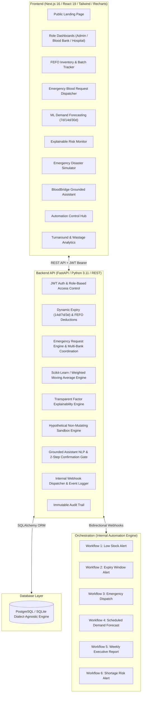

# BloodBridge 🩸
> **Predict. Coordinate. Respond.**  
> AI-Powered Blood Inventory, Demand Forecasting & Emergency Coordination Platform.

---

## 1. System Overview

Traditional blood-bank systems operate reactively:
$$\text{Inventory} \longrightarrow \text{Search} \longrightarrow \text{Reports}$$

**BloodBridge** transforms blood supply chain logistics into an intelligent, proactive operational engine:
$$\text{Monitor} \longrightarrow \text{Predict} \longrightarrow \text{Explain} \longrightarrow \text{Simulate} \longrightarrow \text{Alert} \longrightarrow \text{Coordinate} \longrightarrow \text{Automate}$$

BloodBridge empowers authorized hospital personnel, blood-bank officers, and regional healthcare administrators to anticipate shortages 7 to 30 days in advance, avert avoidable expiry wastage, coordinate multi-institution trauma reserves without manual phone delays, and orchestrate automated escalation protocols.

---

## 2. Platform Architecture



---

## 3. Key Capabilities

### 🩸 1. Blood Inventory & Dynamic Expiry Monitoring
* Tracks batches by Blood Group ($A^+, A^-, B^+, B^-, AB^+, AB^-, O^+, O^-$), Rh factor, collection date, expiry date, storage location, and status (`AVAILABLE`, `RESERVED`, `ISSUED`, `EXPIRED`, `QUARANTINED`).
* Automated expiry tiers: **Normal** (>14d), **Warning** ($\le 14$d), **Urgent** ($\le 7$d), **Critical** ($\le 3$d), and **Expired**.
* Atomic FEFO (*First-Expiry-First-Out*) inventory deductions upon request fulfillment.

### 📈 2. ML Demand Forecasting
* Practical time-series model (linear-weighted moving average over 90-day issue history) projecting demand across 7, 14, and 30-day horizons.
* Displays trend indicators ($\uparrow, \downarrow, \rightarrow$) and shortage flags.
* Clearly labeled as **forecasting estimates**, safeguarding clinical boundaries.

### 🔍 3. Explainable Shortage Risk Engine
* Transparent, non-black-box risk assessment (`HIGH`, `MEDIUM`, `LOW`).
* Displays explicit mathematical drivers: current available units, projected demand, active emergency requests, and approaching expiry batches.

### 🚨 4. Emergency Blood Request & Multi-Bank Coordination
* Hospitals submit requests with priority levels (`NORMAL`, `URGENT`, `CRITICAL`).
* Multi-Blood-Bank Coordination queries availability across all participating network institutions without initiating unauthorized auto-transfers.

### 🤖 5. Grounded BloodBridge AI Assistant
* Natural-language interface directly grounded in live database inventory, ML forecasts, and system docs.
* **Controlled Actions**: Prepares emergency requests with a mandatory **2-step human confirmation gate**.

### ⚡ 6. Internal Automation Workflows
* 6 production automation workflows:
  1. Low Stock Alert: Scheduled threshold scan.
  2. Expiry Alert: Identifies batches expiring $\le 7$ days.
  3. Emergency Request: Instant triage escalation.
  4. Demand Forecast: Weekly ML retrain and dashboard sync.
  5. Weekly Report: Executive consumption and wastage digest.
  6. Shortage Risk Alert: Evaluates high-risk blood groups.

### 📊 7. Analytics & Audit Logging
* Interactive Recharts for daily usage, 30-day group demand, and response turnaround speed.
* Immutable audit trail logging user, timestamp, entity ID, action, and state transitions.

### 👥 8. Donor Management & WHO 56-Day Eligibility
* Complete donor registry tracking demographic profile, verified blood group, contact information, and medical eligibility notes.
* Automatic eligibility enforcement: calculates interval since last donation against the **WHO 56-day cooldown rule** (`Eligible Now` vs `In Cooldown`).
* **Intake Donation Action**: Staff can record incoming donations with Hemoglobin and Blood Pressure checks; system automatically generates a new 42-day expiring batch in `BloodInventory` and resets the donor's cooldown.
* **Emergency Quick-Match**: Instantly isolates ready donors for critical trauma requests (e.g., $O^-$ universal donors).

### ⚡ 9. Real-Time WebSocket Notifications
* Persistent, low-latency WebSocket connection (`/api/v1/ws`) between clients and backend.
* Real-time toast alerts pushed automatically on:
  - Critical/Urgent emergency blood request submissions
  - Blood donations intake & batch registration
  - Request fulfillment & inventory deductions
  - Expiry and low stock warnings
* Live pulse indicator in navigation (`LIVE` vs `SYNC`) and dynamic unread counter.

---

## 4. Technology Stack

* **Frontend**: Next.js 16 (App Router), React 19, TypeScript, Tailwind CSS, Lucide Icons, Recharts.
* **Backend**: FastAPI, Python 3.11, Pydantic v2, Uvicorn.
* **Database & ORM**: PostgreSQL / SQLite (via SQLAlchemy 2.0 with foreign keys & indexes).
* **Machine Learning**: Scikit-learn, Pandas, NumPy.
* **Automation**: Internal event-driven workflow engine.
* **Security**: Passlib (Bcrypt), Python-JOSE (JWT tokens), Role-Based Access Control (RBAC).

---

## 5. Quickstart & Installation

### Prerequisites
* Python 3.11+
* Node.js 18+ & npm
* (Optional) Docker & Docker Compose

### 1. Backend Setup
```bash
# Navigate to backend directory
cd backend

# Create and activate Python virtual environment
python -m venv venv
# On Windows:
venv\Scripts\activate
# On Linux/macOS:
source venv/bin/activate

# Install dependencies
pip install -r requirements.txt

# Run backend development server (automatically seeds demo dataset on first start)
python run.py
```
> Backend runs at: `http://localhost:8000`  
> Interactive OpenAPI documentation: `http://localhost:8000/api/v1/docs`

### 2. Frontend Setup
```bash
# Navigate to frontend directory
cd frontend

# Install dependencies
npm install

# Start Next.js development server
npm run dev
```
> Frontend application runs at: `http://localhost:3000`

### 3. Docker Deployment (Full Stack)
```bash
docker-compose up -d
```

---

## 6. Seed Accounts & Test Credentials

The database initializes automatically with realistic synthetic healthcare data:

| Role | Email | Password | Scope & Permissions |
| :--- | :--- | :--- | :--- |
| **System Administrator** | `admin@bloodbridge.org` | `admin123` | Full access, settings, audit logs, user management |
| **Blood Bank Staff** | `bloodbank@bloodbridge.org` | `bloodbank123` | Inventory CRUD, batch status, FEFO fulfillment, risk engine |
| **Hospital Staff** | `hospital@bloodbridge.org` | `hospital123` | Request submission, status tracking, emergency coordination |

---

## 7. End-to-End Demonstration Walkthrough

Follow this 20-step verification sequence to demo all major capabilities:

1. **Login as Administrator**: Sign in with `admin@bloodbridge.org` / `admin123`.
2. **View Global Dashboard**: Inspect system-wide inventory totals, expiry warnings, and active emergency requests.
3. **Inspect Inventory**: Navigate to `/inventory` to view blood batches categorized by expiry urgency (`Critical`, `Urgent`, `Normal`).
4. **Switch to Hospital Account**: Sign out and sign in with `hospital@bloodbridge.org` / `hospital123`.
5. **Create Emergency Request**: Navigate to `/requests`, click **New Blood Request**, select **O-**, Quantity **6 units**, Priority **Critical**.
6. **Trigger Multi-Bank Coordination**: Open Blood Bank availability check to see real-time supply across Central Blood Bank and Red Cross.
7. **Switch to Blood Bank Staff**: Sign in with `bloodbank@bloodbridge.org` / `bloodbank123`.
8. **Process Request**: Open `/requests`, review the pending critical request, and approve it.
9. **FEFO Fulfillment**: Click **Fulfill Request** to perform atomic FIFO/FEFO deduction from the oldest available batch.
10. **Open Risk Monitor**: Navigate to `/risk`. Observe the explainable reasons why **O-** or **AB-** are flagged as `HIGH RISK`.
11. **Open AI Demand Forecasts**: Navigate to `/forecasts`. Toggle between 7, 14, and 30-day projection windows.
12. **Interact with AI Assistant**: Navigate to `/assistant`. Ask:
    > *"Why is O- showing high shortage risk?"*  
    > Verify the chatbot retrieves live database factors and forecast metrics.
13. **Chatbot Controlled Action**: In the Assistant chat, enter:
    > *"Create an emergency request for 2 units of O-"*  
    > Observe the **Human Approval Gate** card appear. Click **Confirm & Execute**.
14. **Automation Hub**: Navigate to `/automation`. Inspect the 6 configured workflows and click **Trigger** on `low-inventory`.
15. **Review Event Stream**: Observe the recorded automation event in the live execution table.
16. **Open Analytics**: Navigate to `/analytics` to inspect 14-day transfusion trends, forecast accuracy metrics, and wastage rates.
17. **Inspect Audit Trail**: Navigate to `/audit` (as Admin) to verify the immutable log of every action taken during the demo.

---

## 8. License & Principles

BloodBridge is designed to augment human medical teams:  
**Monitor → Analyze → Predict → Alert → Coordinate**  
Human clinical staff remain exclusively responsible for patient transfusion and allocation decisions.
